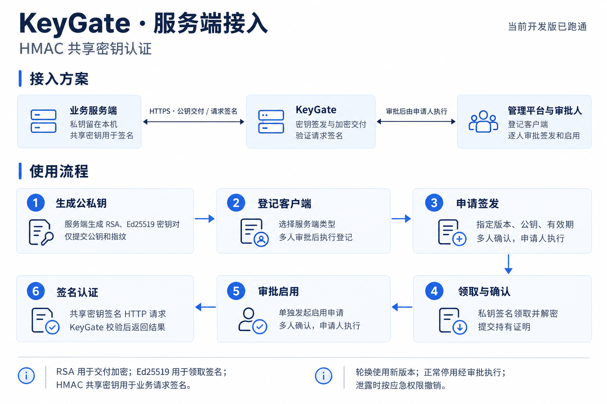
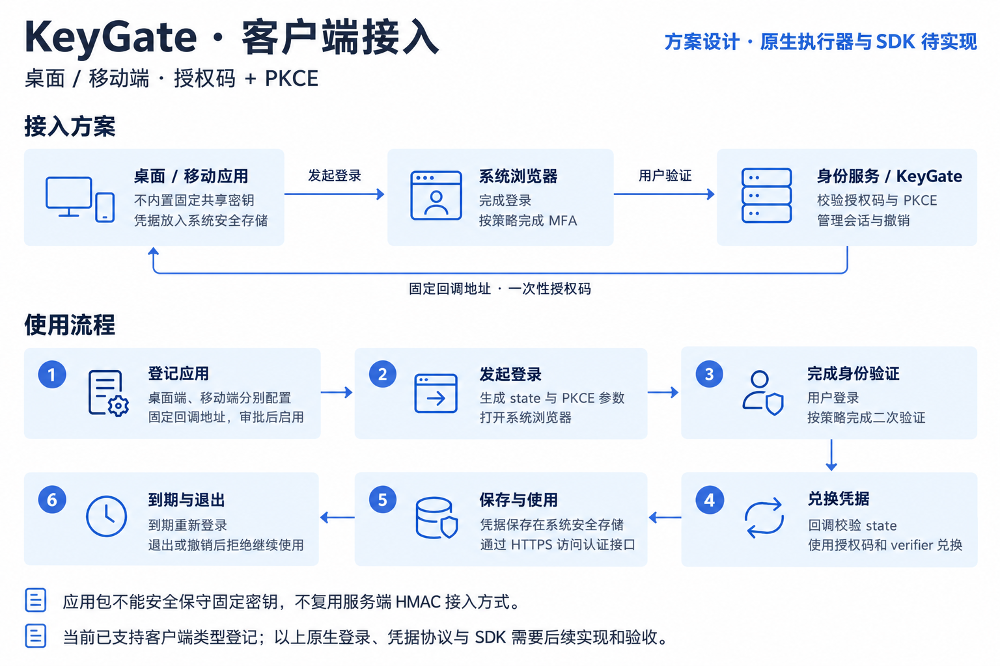
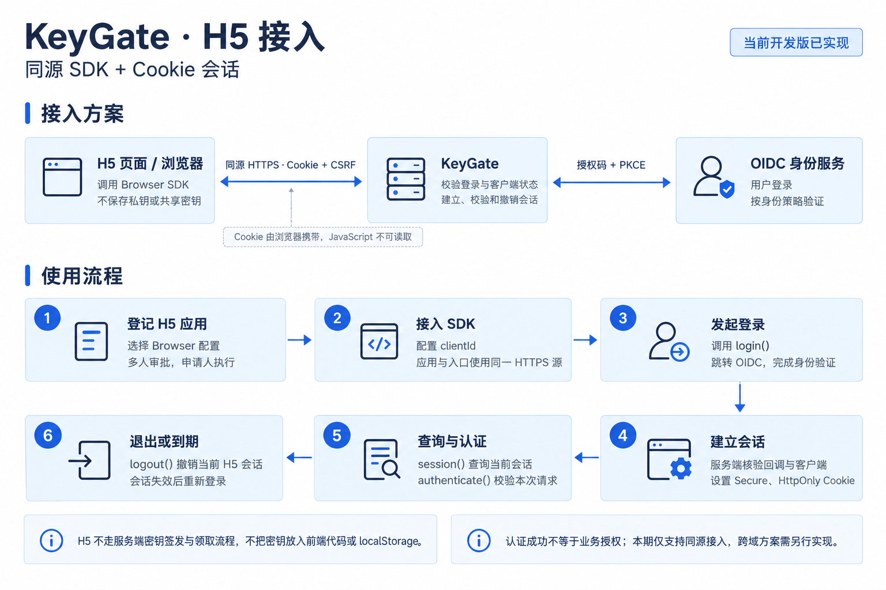

# ExKeyGate

基于 Go 的认证与密钥管理服务，支持共享密钥、插件扩展和多人授权。

管理流程：客户端登记 → 密钥申请 → 逐人审批 → 签发与领取 → 审批启用 → 请求认证 → 轮换或停用。

当前为开发测试版本。服务端 HMAC 和同源 H5 流程已实现；桌面与移动端执行器、原生 SDK、KMS/HSM 接入及生产部署验收尚未完成。

- [功能状态](#功能状态)
- [待完善功能与验收清单](docs/待完善功能清单.md)
- [三类接入方案](#三类接入方案)
- [本地运行](#本地运行)
- [验证](#验证)
- [文档导航](#文档导航)

## 功能状态

| 模块 | 当前能力与限制 |
| --- | --- |
| 管理登录 | 账号密码 + 原生二次验证，保留 OIDC/SSO；本机模拟身份仅供测试 |
| 人员与审批 | 管理人员登记、启停、六类角色范围与审批策略在线治理；冻结人员顺序，逐人验证、确认与交接；达到 M 人同意后由申请人执行 |
| 服务端密钥 | 签发、一次性加密交付、持有证明、审批启用、HMAC 请求签名与防重放 |
| 应用信任链 | 多个独立应用根、离线签发、多人审批发布、轮换与撤销、证书详情、PEM/DER 下载、版本追踪、续期审批、到期提醒与状态签名器受控更新；Go 验证库与开发 CLI、独立根恢复 |
| 生命周期 | 轮换、停用、泄露撤销、隔离恢复、审计查询、导出及签名归档 |
| H5 | 同源 Cookie 会话、TypeScript/ESM SDK、登录、认证和退出 |
| 桌面与移动端 | 支持独立客户端配置；完整认证执行器与原生 SDK 待实现 |
| 插件 | 内部软件实现、通用 HTTPS/mTLS 适配器和本机模拟插件；真实厂商接入需单独验收 |
| MFA | 邮件、短信、TOTP、硬件验证策略；邮件、短信和硬件需配置可信插件，未接入不放行 |
| 多节点 | 应用节点共享 PostgreSQL 权威状态，支持并发认证、租约与旧节点隔离；数据库主备和多中心部署待验收 |
| KMS/HSM | 保留接口，实际托管与硬件接入延后 |

人员授权、验证方式绑定和策略应用目前采用受控离线配置。开发软件根、模拟 SSO、接口预留及本机测试结果均不代表生产安全验收通过。

## 三类接入方案

### 服务端接入

适用于后端服务之间的 HMAC 共享密钥认证。业务服务端生成并保管接收方私钥，只向管理平台提交公钥与指纹；KeyGate 经审批签发密钥，由接收方加密领取并完成持有证明，再单独审批启用。



接收方工具为 `cmd/keygate-client`，支持生成公私钥、领取和签名认证。领取完成后先刷新管理台数据，再发起启用申请。

详见[客户端密钥 HTTP 流程](docs/客户端密钥HTTP流程.md)和[请求签名认证](docs/请求签名认证.md)。

### 桌面与移动客户端接入

采用授权码 + PKCE 的设计方案。桌面端、移动端分别配置，应用不内置服务端共享密钥。当前已支持类型登记，图中的原生登录、凭据存储、认证执行器和 SDK 仍待实现。



详见[人员权限与客户端模型](docs/人员权限与客户端模型.md)和[客户端策略](docs/客户端策略.md)。

### H5 接入

使用同源 SDK 和 Cookie 会话。用户经 OIDC 登录后，由服务端建立会话；前端不保存私钥或共享密钥，认证成功不代替业务权限判断。本期不支持跨域接入。



SDK 位于 `sdk/browser`，提供 `login()`、`session()`、`authenticate()` 和 `logout()`，演示页面为 `/h5`。

详见[H5 认证与 SDK](docs/H5认证与SDK.md)。三张图也可在[独立图解文档](docs/接入方案与流程图.md)中查看；具体参数与约束以对应文字文档为准。

## 固定根证书接入

支持多套独立根及按根分组的业务证书管理。自己的应用可以内置专用根证书，业务服务端保管私钥；业务私钥泄露后撤销旧证书、审批发布新版本，客户端根保持不变。已实现 Go 验证库 `trustchain` 和工具 `cmd/keygate-trust`，管理入口位于「信任链管理」。这套应用签名协议与上面的 HMAC 领取流程分别配置。

详见[应用信任链与 Go 接入](docs/应用信任链.md)，包含离线签发、CLI、验证、撤销及独立根恢复。开发 CLI 状态服务仅支持本机 HTTPS；生产硬件托管和部署仍待验收。

## 本地运行

工具链为 Go 1.26.9，由 `go.mod` 固定；数据库使用 PostgreSQL，本机开发数据库脚本依赖 Docker。

1. 按[开发登录运行](docs/开发登录运行.md)准备独立开发数据库，按[本地信任证书](docs/本地信任证书.md)准备本机 TLS 证书。
2. 按[原生 MFA 与人员流转](docs/原生MFA与人员流转.md)准备独立验证器，再按[账号密码登录](docs/账号密码登录.md)生成私有开发账号配置。
3. 分别启动模拟 SSO 和开发控制台。以下命令要求对应私有配置、数据库及证书已准备完成。

```sh
# 终端一：本机模拟 SSO
KEYGATE_ENV=development go run ./cmd/mock-sso \
  -redirect https://localhost:18761/auth/callback \
  -tls-dir data/local-tls
```

```sh
# 终端二：开发管理台与认证流程
KEYGATE_ENV=development KEYGATE_ROOT_MODE=development_software \
  go run ./cmd/keygate-dev \
  -enable-key-flow \
  -mfa-config-file data/dev-mfa-plan.json \
  -local-accounts-file data/local-login/accounts.json \
  -tls-dir data/local-tls
```

登录地址：<https://localhost:18761/login>。完成本人二次验证后进入 `/manage`。开发账号 `admin` 对应申请人，`approver1`、`approver2` 对应两名审批人；随机密码和各人的验证器配置通过本机私有文件管理，不提交到仓库。

默认 `go run ./cmd/keygate` 仅提供 `GET http://127.0.0.1:18760/health/live` 存活检查，不自动开放管理和认证业务。开发演示进程重启会创建新的隔离域和临时根，不应将重启当作恢复方式。恢复流程见[生命周期运行手册](docs/生命周期运行手册.md)。

## 验证

```sh
# 开发安全验收：静态检查、SDK、漏洞检查、PostgreSQL race 与故障测试
python3 scripts/security-acceptance.py

# 独立临时 PostgreSQL 集成测试，结束后清理测试容器
python3 scripts/test-postgres.py

# 跨语言请求签名固定向量
python3 scripts/signature-vector.py
```

普通 `go test ./...` 未配置专用测试数据库时会跳过数据库集成用例。开发验收通过不等于生产发布通过；真实身份、厂商插件、KMS/HSM、数据库主备、多中心部署和组织安全评审仍需分别验收。

## 文档导航

| 主题 | 文档 |
| --- | --- |
| 设计与实施 | [待完善清单](docs/待完善功能清单.md) · [功能设计](docs/功能设计.md) · [实施计划](docs/实施计划.md) · [实施进度](docs/实施进度.md) |
| 管理台与登录 | [运营管理后台](docs/运营管理后台.md) · [账号密码登录](docs/账号密码登录.md) · [OIDC 身份接入](docs/OIDC身份接入.md) |
| 人员与审批 | [人员权限与客户端模型](docs/人员权限与客户端模型.md) · [人员与审批策略在线治理](docs/人员与审批策略在线治理.md) · [审批执行闭环](docs/审批执行闭环.md) · [原生 MFA 与人员流转](docs/原生MFA与人员流转.md) |
| 密钥与认证 | [软件密钥操作闭环](docs/软件密钥操作闭环.md) · [客户端密钥 HTTP 流程](docs/客户端密钥HTTP流程.md) · [请求签名认证](docs/请求签名认证.md) |
| 接入方式 | [三类接入图解](docs/接入方案与流程图.md) · [客户端策略](docs/客户端策略.md) · [H5 认证与 SDK](docs/H5认证与SDK.md) |
| 应用信任链 | [固定根、Go 验证库与 CLI](docs/应用信任链.md) · [证书详情与历史](docs/证书详情与历史.md) · [证书续期、到期提醒与状态签名器更新](docs/证书续期与到期提醒.md) |
| 运维与插件 | [生命周期运行手册](docs/生命周期运行手册.md) · [插件管理](docs/插件管理.md) · [多节点与安全验收](docs/多节点与安全验收.md) |
| 本机开发 | [开发登录运行](docs/开发登录运行.md) · [模拟 SSO](docs/模拟SSO.md) · [本地信任证书](docs/本地信任证书.md) |
